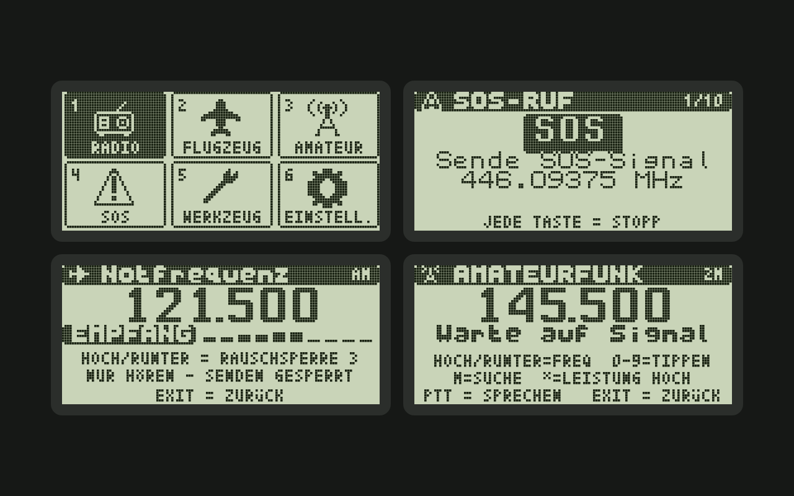

# UV-K5 SOS-Edition

Eigene Firmware für das Funkgerät **Quansheng UV-K5 (8)**: ganz einfach zu bedienen, mit einem Menü aus sechs Kacheln und einem automatischen SOS-Ruf.



Grundlage ist die freie Firmware [F4HWN](https://github.com/armel/uv-k5-firmware-custom) (Stand `fbcf26d`). Die SOS-Edition ersetzt den komplizierten Frequenz-Bildschirm durch einfache Seiten. Auf jeder Seite steht unten, was die Tasten gerade tun.

## Was sie kann

| Kachel | Was passiert |
|---|---|
| **1 Radio** | UKW-Radio, Sendersuche mit `HOCH` / `RUNTER` |
| **2 Flugzeug** | Flugfunk hören (Suche 130–136 MHz, Notfrequenz 121,5 MHz). Senden ist hier gesperrt. |
| **3 Amateur** | Frequenz selbst wählen oder eintippen, mit `PTT` sprechen |
| **4 SOS** | Automatischer SOS-Ruf als Morsezeichen, danach 15 Sekunden hören. SOS-Licht, PMR-Kanal 8. |
| **5 Werkzeug** | Taschenlampe, SOS-Licht, Akku-Anzeige, Tastensperre, Notfall-Pfeife |
| **6 Einstellungen** | Energiesparen, Tastentöne, Rauschsperre, Rauschfilter, Auto-Sperre |

Ausserdem:

- **M = OK**, **EXIT = zurück**, **PTT = sprechen** (nur wo erlaubt)
- **Echte Umlaute** (ä ö ü ß) auf dem Display
- **10 Signalbalken** zeigen, wie stark ein Sender ist
- **Akku-Warnung**, wenn der Akku fast leer ist
- Schneller Start mit eigenem Startbild

Die ganze Bedienung steht in der Anleitung: [LIESMICH-SCHNELLWAHL.md](LIESMICH-SCHNELLWAHL.md).

## Welche Geräte?

Nur für **UV-K5 (8) / UV-K6 / UV-5R Plus mit DP32G030-Chip**.
**Nicht** für UV-K5 V3 oder UV-K1 verwenden.

## Installieren (Flashen)

1. **Download:** `f4hwn.sos.packed.bin` unter [Releases](https://github.com/Samir-Aextryx/uv-k5-sos-firmware/releases/latest) herunterladen.
2. **Backup machen:** Die Kalibrierdaten sind für jedes Gerät anders. In CHIRP mit „Download from radio“ ein Abbild ziehen und speichern.
3. Funkgerät ausschalten, **PTT gedrückt halten und einschalten**. Die Lampe leuchtet, das Display bleibt leer.
4. Programmierkabel anschliessen.
5. In Chrome oder Edge <https://egzumer.github.io/uvtools/> öffnen → **Firmware flasher** → Datei auswählen → **Flash**.
6. Neu starten. Das Startbild erscheint, danach die Kacheln.

Zurück zur alten Firmware geht jederzeit auf dem gleichen Weg.

> Flashen auf eigenes Risiko. Vorher immer ein Backup machen.

## Wichtig: Rechtliches

- **Flugfunk:** nur hören. Senden ist in der Firmware gesperrt.
- **Amateurfunk:** Senden nur mit Amateurfunk-Lizenz und Rufzeichen. Hören darf jeder.
- **PMR446 und Freenet:** Das UV-K5 hat dafür keine Zulassung. Senden nur in echter Not.
- **SOS-Ruf:** nur in einem echten Notfall benutzen. Ein falscher Notruf ist strafbar und blockiert Funkkanäle für andere.

Die Regeln sind je nach Land verschieden. Bitte informiere dich, was bei dir gilt.

## Selbst bauen

Du brauchst Docker Desktop. In Git Bash:

```sh
docker build -t uvk5-build .
./build-sos.sh
```

Die fertige Datei liegt danach in `compiled-firmware/f4hwn.sos.packed.bin`.
Welche Dateien geändert sind, steht am Ende von [LIESMICH-SCHNELLWAHL.md](LIESMICH-SCHNELLWAHL.md).

## Dank und Lizenz

- Firmware-Grundlage: [F4HWN / armel](https://github.com/armel/uv-k5-firmware-custom), aufbauend auf egzumer und DualTachyon. Die Original-README liegt unter [README-F4HWN.md](README-F4HWN.md).
- SOS-Edition: [Samir Sali](https://samirsali.ch)
- Lizenz: Apache 2.0, siehe [LICENSE](LICENSE)
